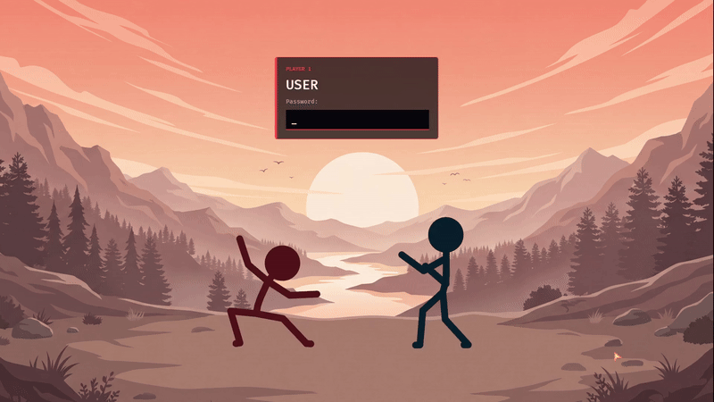

# FG Greeter

Figthing game greeter - A Linux greeter with a fighting game animation.

The goal is to have a fun greeter where entering your password simulate a fighting game experience. 
When you press any characters, your fighter will hit the opponent, comboing if you are typing fast enough.
If you provided the correct password, you will deliver a finishing blow and enter your session.
Otherwise, you will be countered and a new round starts !

To use this greeter, [see the installation guide](#install)

You can also quickly try it out with a fake greeter with the `test-greeter.sh` script,
that requires to compile the fakegreet package from [greetd](https://github.com/kennylevinsen/greetd) 



### Status

The functionnal part of logging in is working, with a clean state machine handling greetd.
The state machine sends animations events that are then used to run the animation.

I am no artist, and both the background and my animations are terrible (the background is AI generated and it shows, I made it to have something that matches my theme).
I'd like to make them way better, and any help is appreciated !

This greeter is currently using bevy, and while it's fine for a quick result, I'd like to migrate away from it.
The issue is that Bevy has a tendency to panic, and we can't let a greeter panic when something is wrong.
I would like a more robust solution, and since the visual part is super simple anyway (only one object),
I'd like to move to a simpler way of rendering / animating the scene.

### Contributing 

Anyone is welcome to help, for the code or art. 
Currently, the code is fully working, so the art and animations is the main pain point of this project.

### Install

#### NixOS

To use this on NixOS, you have to build it from source manually:

```nix
{ lib, pkgs }:
let
  fgGreeterSrc = pkgs.fetchFromGitHub {
    owner = "VirgileHenry";
    repo = "fggreeter";
    rev = "ef756a85f6b633a8eb09c81ad3f9f1ebf07b9cc7"; # Last commit
    sha256 = ""; # enter git sha here when rebuilding
  };

  # winit/wgpu dlopen these at runtime
  ldLibPath = lib.makeLibraryPath [ pkgs.wayland pkgs.libxkbcommon pkgs.vulkan-loader ];
  ldPrefix = "--prefix LD_LIBRARY_PATH : ${ldLibPath}";
  assetFolder = "--set BEVY_ASSET_ROOT $out/share/fggreeter";
  postFixup = "wrapProgram $out/bin/fggreeter ${ldPrefix} ${assetFolder}";
in
pkgs.rustPlatform.buildRustPackage {
  pname = "fggreeter";
  version = "0.1.0";
  src = fgGreeterSrc;
  cargoHash = "="; # enter cargo sha here when rebuilding
  nativeBuildInputs = [
    pkgs.pkg-config
    pkgs.makeWrapper
  ];
  buildInputs = [
    pkgs.wayland
    pkgs.libxkbcommon
    pkgs.udev
    pkgs.alsa-lib
  ];
  meta = {
    description = "Fighting Game Greeter";
  };
  postInstall = ''
    mkdir -p $out/share/fggreeter
    cp -r assets $out/share/fggreeter/
  '';
  postFixup = postFixup;
}
```

And then it can be used like so:

```nix
{ lib, config, pkgs, ... }:
let
  fgGreeter = import ./fggreeter.nix { lib = lib; pkgs = pkgs; };
  greeterEnv = "${pkgs.coreutils}/bin/env XKB_DEFAULT_LAYOUT=fr RUST_BACKTRACE=1";
  cage = "${pkgs.cage}/bin/cage -s -m last --";
  greeter = "${fgGreeter}/bin/fggreeter --user eclipse --command start-hyprland --log-file /var/log/fggreeter/fggreeter.log";
in
{
  # Greeter
  services.displayManager.gdm.enable = false;
  services.greetd = {
    enable = true;
    settings.default_session = {
      command = lib.concatStringsSep " " [ greeterEnv cage greeter ];
      user = "greeter";
    };
  };
  # This creates a log file for the greeter, useful if something goes wrong
  systemd.tmpfiles.rules = [ "d /var/log/fggreeter 0755 greeter greeter -" ];
}
```

Since this uses bevy for now, it might take a few minutes to build.

#### Not NixOS

I'm using NixOS, and I have no clue on how to set up a custom greeter for other distros. Dig it up !

### License

The code is licensed under the [Apache 2.0 license](LICENSE).
